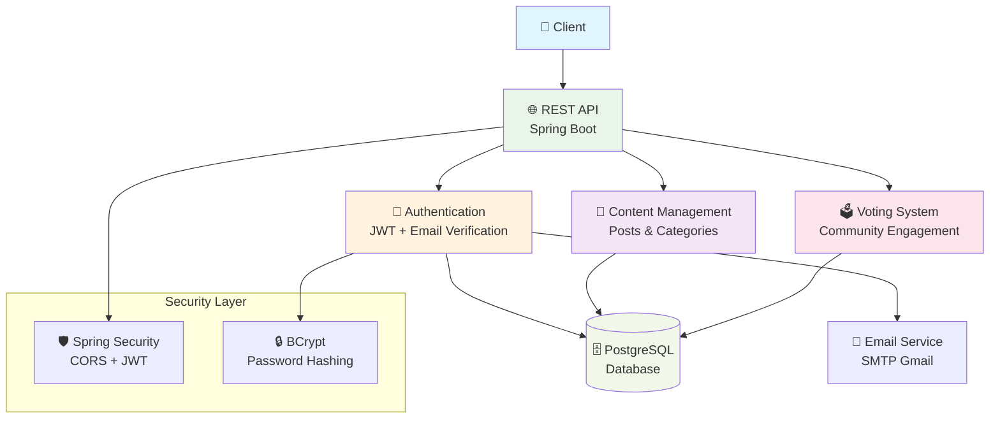
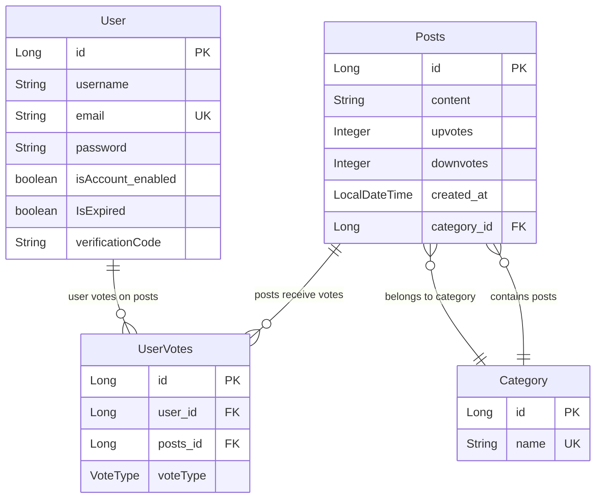
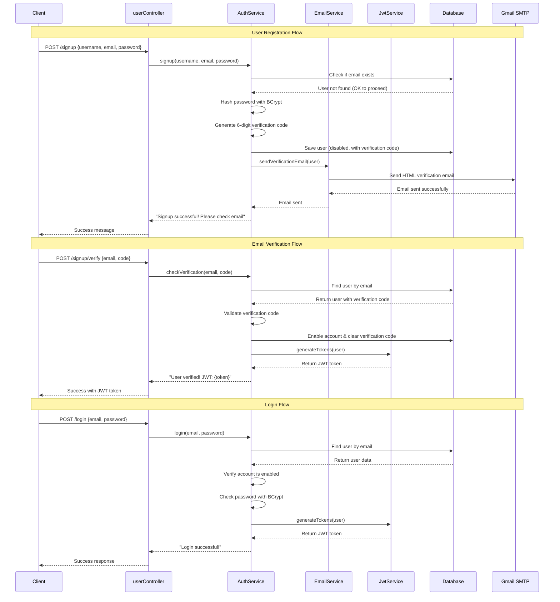
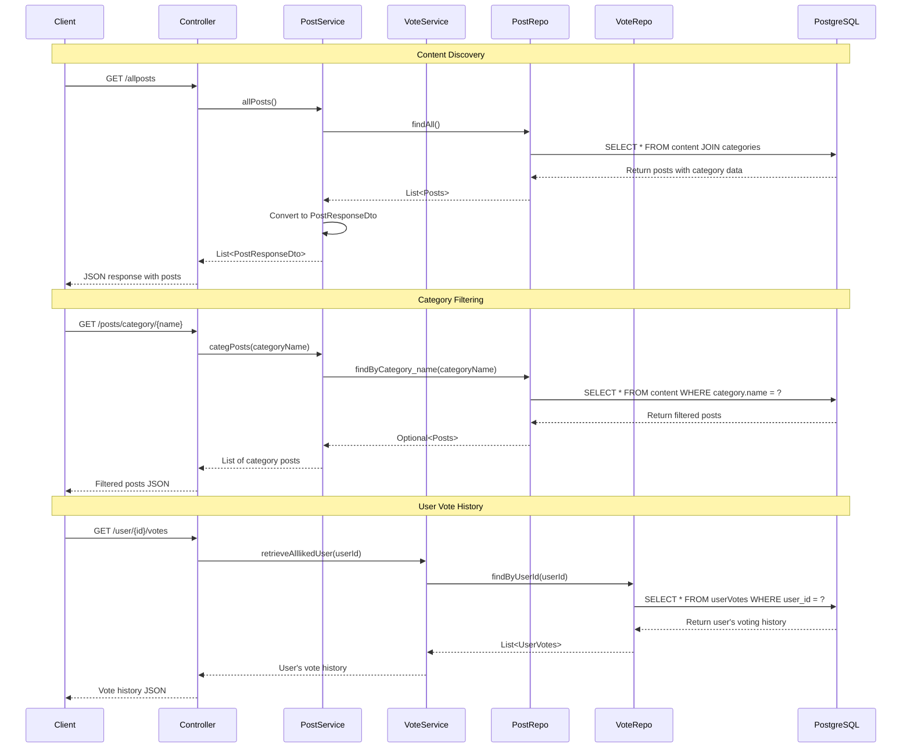
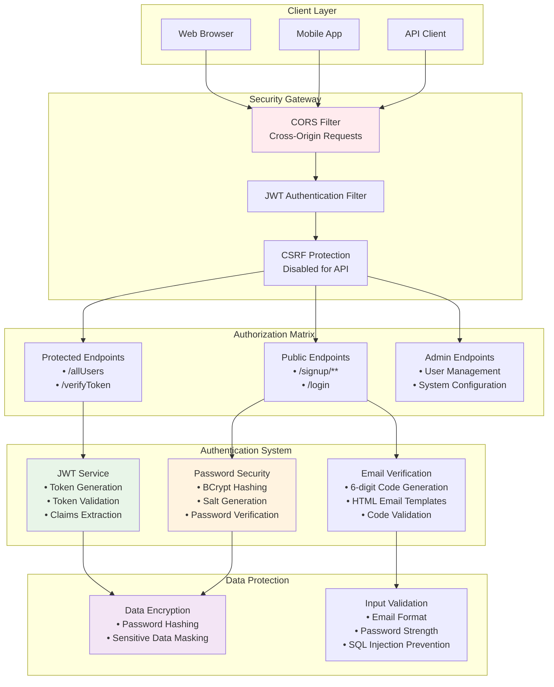
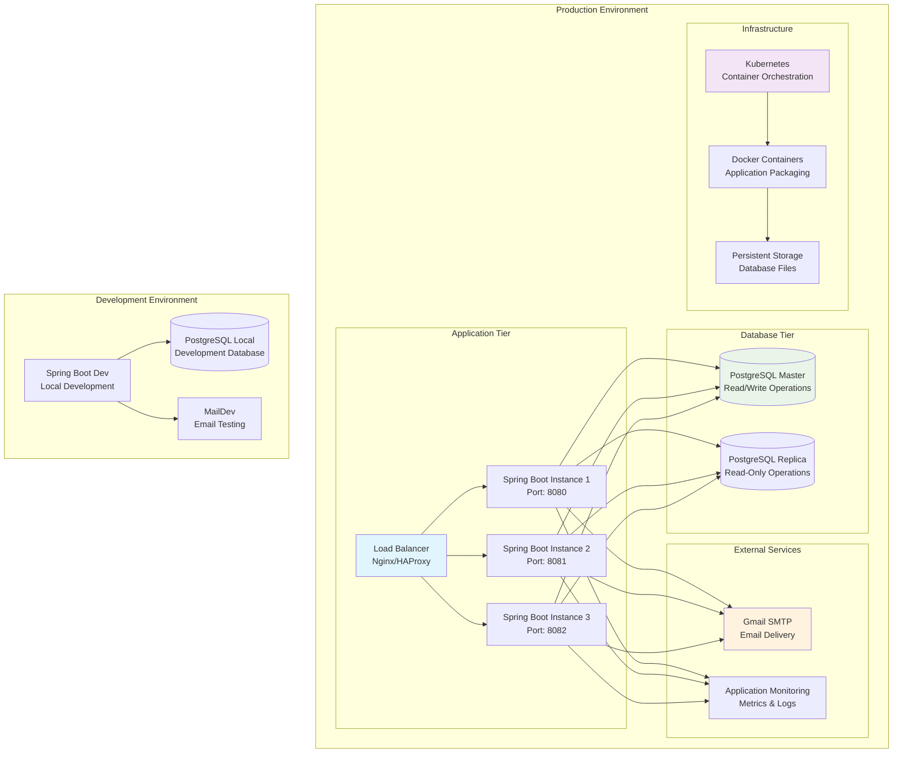
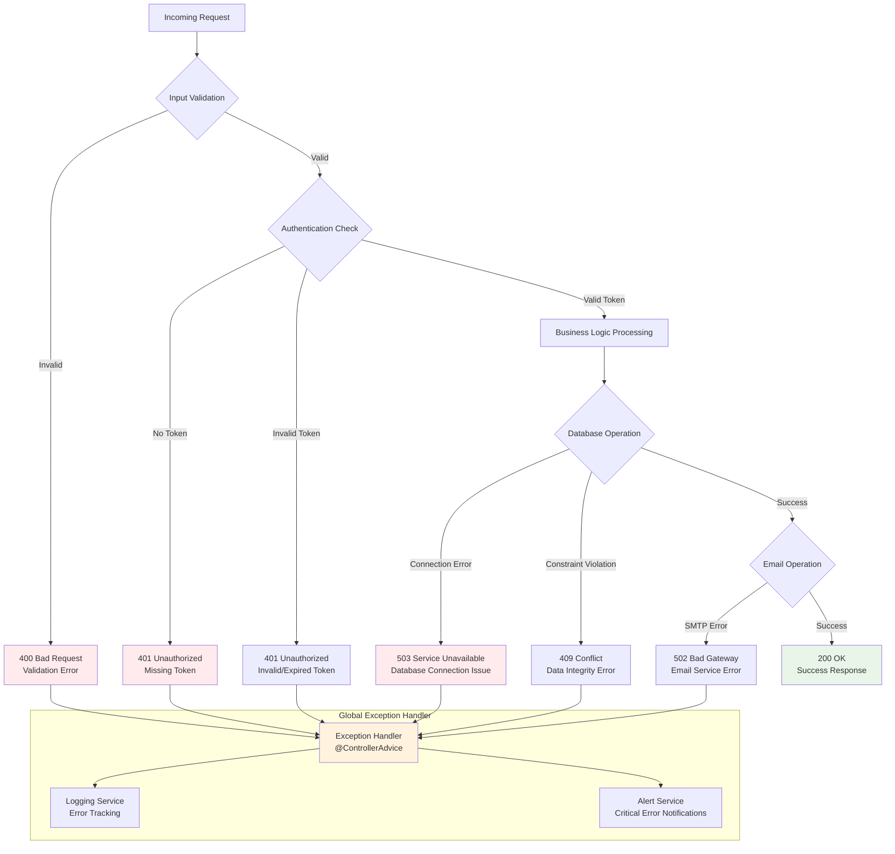

# Forge-Mind - Mermaid Architecture Diagrams

## 1. High-Level System Architecture



## 2. Detailed Component Architecture

```mermaid
graph TD
    subgraph "Presentation Layer"
        Controller[userController<br/>REST Endpoints]
        DTO[DTOs<br/>• Signup<br/>• LoginDto<br/>• VerifyDto<br/>• PostResponseDto]
    end
    
    subgraph "Business Logic Layer"
        AuthService[AuthService<br/>• signup()<br/>• login()<br/>• checkVerification()]
        UserService[UserService<br/>• allUsers()]
        PostService[PostService<br/>• allPosts()<br/>• categPosts()]
        VoteService[VoteService<br/>• retrieveAlllikedUser()]
        JwtService[JwtService<br/>• generateTokens()<br/>• verifyToken()]
        EmailService[EmailService<br/>• SendVerificationMail()]
    end
    
    subgraph "Data Access Layer"
        UserRepo[UserRepository<br/>JPA Repository]
        PostRepo[PostRepository<br/>findByCategory_name()]
        VoteRepo[UserVoteRepository<br/>findByUserId()]
        CategoryRepo[CategRepository]
    end
    
    subgraph "Database Entities"
        UserEntity[User Entity<br/>• id, username, email<br/>• password, isEnabled<br/>• verificationCode]
        PostEntity[Posts Entity<br/>• id, content<br/>• upvotes, downvotes<br/>• created_at]
        CategoryEntity[Category Entity<br/>• id, name<br/>• posts (OneToMany)]
        VoteEntity[UserVotes Entity<br/>• user, posts<br/>• voteType (ENUM)]
    end
    
    Controller --> DTO
    Controller --> AuthService
    Controller --> UserService
    Controller --> PostService
    Controller --> VoteService
    
    AuthService --> UserRepo
    AuthService --> JwtService
    AuthService --> EmailService
    PostService --> PostRepo
    VoteService --> VoteRepo
    
    UserRepo --> UserEntity
    PostRepo --> PostEntity
    VoteRepo --> VoteEntity
    CategoryRepo --> CategoryEntity
    
    style Controller fill:#e1f5fe
    style AuthService fill:#e8f5e8
    style UserEntity fill:#fff3e0
    style PostEntity fill:#f3e5f5
```

## 3. Database Entity Relationship Diagram



## 4. Authentication Flow Diagram



## 5. Content Management Flow



## 6. Security Architecture



## 7. Deployment Architecture



## 8. Technology Stack Overview

```mermaid
graph TB
    subgraph "Frontend Tier"
        React[React/Angular<br/>Web Application]
        Mobile[React Native<br/>Mobile Application]
        API_Docs[OpenAPI/Swagger<br/>API Documentation]
    end
    
    subgraph "Backend Tier"
        subgraph "Spring Boot 3.5.3"
            Web[Spring Web<br/>REST Controllers]
            Security[Spring Security<br/>JWT Authentication]
            Data[Spring Data JPA<br/>Repository Pattern]
            Mail[Spring Mail<br/>Email Integration]
        end
        
        subgraph "Java Ecosystem"
            Java24[Java 24<br/>Latest LTS]
            Maven[Apache Maven<br/>Build Tool]
            Lombok[Project Lombok<br/>Code Generation]
        end
    end
    
    subgraph "Database Tier"
        PostgreSQL[(PostgreSQL 15<br/>Primary Database)]
        Hikari[HikariCP<br/>Connection Pooling]
        Hibernate[Hibernate ORM<br/>JPA Implementation]
    end
    
    subgraph "External Services"
        Gmail[Gmail SMTP<br/>Email Service]
        JWT[JWT Library<br/>io.jsonwebtoken]
        BCrypt[BCrypt<br/>Password Hashing]
    end
    
    subgraph "DevOps & Monitoring"
        Docker_Icon[Docker<br/>Containerization]
        K8s_Icon[Kubernetes<br/>Orchestration]
        Prometheus[Prometheus<br/>Metrics Collection]
        ELK[ELK Stack<br/>Logging]
    end
    
    React --> Web
    Mobile --> Web
    API_Docs --> Web
    
    Web --> Security
    Web --> Data
    Web --> Mail
    
    Security --> JWT
    Security --> BCrypt
    Data --> Hibernate
    Data --> Hikari
    Mail --> Gmail
    
    Hibernate --> PostgreSQL
    Hikari --> PostgreSQL
    
    Java24 --> Maven
    Maven --> Lombok
    
    Docker_Icon --> K8s_Icon
    K8s_Icon --> Prometheus
    Prometheus --> ELK
    
    style React fill:#61dafb
    style Security fill:#6db33f
    style PostgreSQL fill:#336791
    style Docker_Icon fill:#2496ed
    style JWT fill:#000000
```



## 9. Error Handling & Resilience



## Usage Instructions

1. **Copy any diagram** you want to use for presentations
2. **Paste into Mermaid Live Editor** (https://mermaid.live)
3. **Export as PNG/SVG** for documentation or slides
4. **Embed in README** using Mermaid syntax in GitHub

## Interview Strategy

### **Start with Overview** (Diagram 1)
- Show the high-level architecture
- Explain the three main business domains

### **Deep Dive Technical** (Diagrams 2, 3)
- Component architecture shows Spring Boot expertise
- Entity relationship demonstrates database design skills

### **Process Flows** (Diagrams 4, 5)
- Authentication flow shows security understanding
- Content management shows business logic implementation

### **Production Readiness** (Diagrams 6, 7, 9)
- Security architecture demonstrates enterprise thinking
- Deployment architecture shows scalability planning
- Error handling shows production-ready mindset

### **Technology Expertise** (Diagram 8)
- Modern tech stack selection
- Integration complexity management
- DevOps and monitoring awareness

These diagrams demonstrate:
- **Enterprise Architecture Skills**: Complex system design
- **Security Expertise**: Authentication and authorization
- **Database Design**: Normalized relational model
- **API Design**: RESTful service architecture
- **Production Thinking**: Scalability and monitoring
- **Modern Technologies**: Latest Spring Boot and Java
